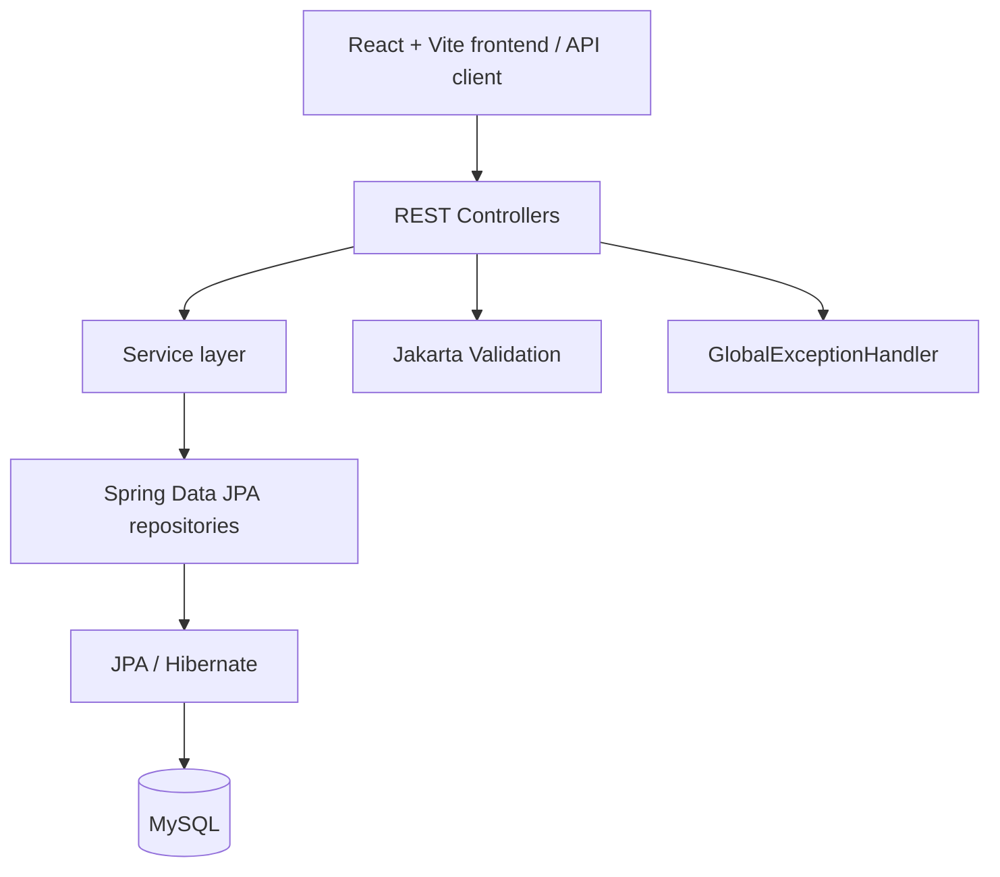

# Smart Nutrition Analysis and Personalized Meal Recommendation System

## Overview
Smart Nutrition is a REST-based application for maintaining user nutrition profiles, managing food nutrition data, recording meals, summarizing daily nutrient intake, and suggesting foods that fit a user's diet type and remaining calorie allowance.

## Problem statement
People may find it difficult to track daily food intake consistently and compare their consumption with a personal calorie target. This project provides APIs and a React frontend for storing food data and meal logs and summarizing daily intake.

## Objectives
- Maintain user profiles and calculate a daily calorie target from profile details.
- Store nutritional values for food items.
- Record a user's food intake by date and serving quantity.
- Summarize calories, protein, carbohydrates, fat, and remaining calories.
- Recommend foods based on diet type, remaining calories, and protein content.

## Implemented features
- User CRUD APIs.
- Food CRUD APIs.
- Meal logging, date-based meal-log retrieval, and deletion.
- Daily nutrition summary.
- Food recommendations.
- Input validation and centralized JSON error responses.
- Seed insertion of 20 foods when the food table is empty.
- React/Vite frontend files are included in `frontend/`.

## Technology stack
| Area | Technology verified in project files |
|---|---|
| Backend language | Java 17 |
| Framework | Spring Boot 4.1.1 |
| Build | Maven / Maven Wrapper |
| Web | Spring Web MVC |
| Persistence | Spring Data JPA and Hibernate |
| Database | MySQL; configured database name `nutritiondb` |
| Validation | Jakarta Validation |
| API documentation | Springdoc OpenAPI / Swagger UI |
| Tests | JUnit 5, Mockito, Spring Boot test dependencies |
| Frontend | React, Vite, Axios, React Router, Recharts, Lucide React |

## Architecture


## Project structure
```text
smart-nutrition/
├── README.md
├── pom.xml
├── mvnw.cmd
├── src/main/java/com/nutrition/smart_nutrition/
│   ├── controller/
│   ├── config/
│   ├── dto/
│   ├── exception/
│   ├── model/
│   ├── repository/
│   ├── service/
│   ├── DataSeeder.java
│   └── SmartNutritionApplication.java
├── src/main/resources/application.properties
├── src/test/java/com/nutrition/smart_nutrition/
├── docs/
└── frontend/
    ├── package.json
    └── src/
```

## Requirements
- JDK 17
- MySQL 8.x (or a compatible MySQL server)
- Node.js and npm for the frontend
- Windows PowerShell instructions are in [setup-and-installation.md](docs/setup-and-installation.md).

## Database setup and configuration
Create the configured database before starting the backend:
```sql
CREATE DATABASE nutritiondb;
```
The current `src/main/resources/application.properties` configures `jdbc:mysql://localhost:3306/nutritiondb`, a database username, and a password. The uploaded file contains literal credentials; do not publish them. Before sharing the repository, move credentials to environment variables or a local untracked configuration file and rotate any real password that has been committed. This documentation does not reproduce the password.

The project uses `spring.jpa.hibernate.ddl-auto=update`; Hibernate updates the schema based on entities. `DataSeeder` inserts 20 sample foods only when the food table is empty.

## Run the backend (PowerShell)
From the project root:
```powershell
.\mvnw.cmd clean test
.\mvnw.cmd spring-boot:run
```
The backend's default local base URL is `http://localhost:8080`.

## Run the frontend
Open another PowerShell terminal:
```powershell
cd frontend
npm install
npm run dev
```
Use the local URL printed by Vite. `WebConfig` allows browser origins `http://localhost:5173`, `http://localhost:5174`, and `http://localhost:5175`.

## API documentation
- Swagger UI: `http://localhost:8080/swagger-ui.html`
- OpenAPI JSON: `http://localhost:8080/v3/api-docs`
- Detailed endpoint list and examples: [API documentation](docs/api-documentation.md)
- The repository includes `postman_collection.json` for Postman-based API testing.

## Example requests
Create a user (enum values must match the Java enums):
```http
POST http://localhost:8080/api/users
Content-Type: application/json
```
```json
{
  "name": "Sample User",
  "email": "sample.user@example.com",
  "age": 22,
  "gender": "MALE",
  "heightCm": 172.0,
  "weightKg": 68.0,
  "activityLevel": "MODERATE",
  "goal": "MAINTAIN",
  "dietType": "VEG"
}
```
`dailyCalorieTarget` is calculated by the backend. To log a meal, send:
```http
POST http://localhost:8080/api/meal-logs
Content-Type: application/json
```
```json
{
  "userId": 1,
  "foodId": 1,
  "logDate": "2026-10-20",
  "servings": 2.0
}
```
Get a summary with `GET /api/users/1/nutrition-summary?date=2026-10-20`, or omit `date` to use the current date. Recommendations use today's date.

## Testing
Run `.\mvnw.cmd clean test`. Existing test classes and scenarios are described in [testing.md](docs/testing.md). A previous project note records a 29-test successful run, but this documentation-generation pass has not independently rerun the tests; verify the current checkout before submission.

## Limitations and future enhancements
- Recommendations are rule-based, not generated by machine learning.
- Nutrition values depend on the data stored for each food and serving.
- The calorie target is an estimate and should not be treated as medical advice.
- Authentication/authorization and user-specific access control are not implemented in the inspected backend.
- Potential future work: authentication, more flexible food search/filtering, stronger API response DTOs, additional integration tests, and configurable nutrition rules.

## Documentation index
- [Project overview](docs/project-overview.md)
- [Architecture](docs/architecture.md)
- [Modules](docs/module-documentation.md)
- [API documentation](docs/api-documentation.md)
- [Database design](docs/database-design.md)
- [Testing](docs/testing.md)
- [Setup and installation](docs/setup-and-installation.md)
- [User guide](docs/user-guide.md)
- [Glossary](docs/glossary.md)
