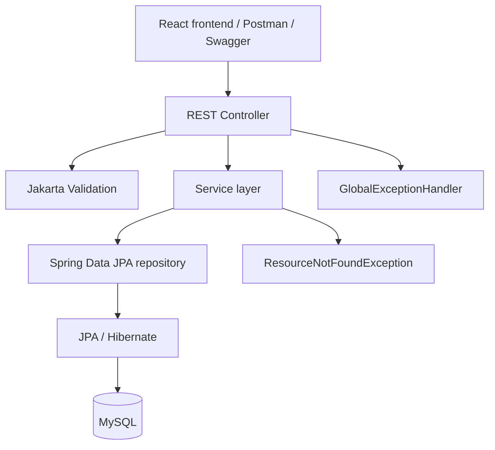
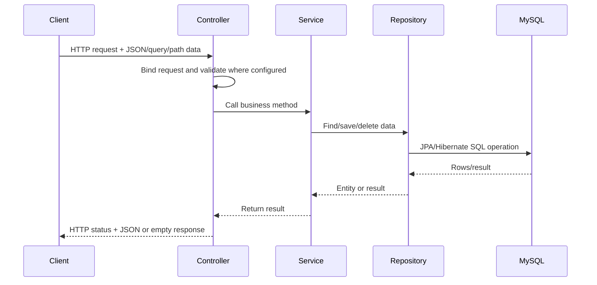

# System Architecture

## Overview
The backend uses a layered Spring architecture. The React/Vite frontend can call the REST endpoints; controllers delegate to services, services use repositories, and Spring Data JPA/Hibernate persists entities in MySQL.

## Architecture diagram

## Request-response sequence

## Layers and important classes
- **Application entry point:** `SmartNutritionApplication` starts Spring Boot.
- **Controller:** `UserController`, `FoodController`, `MealLogController`, and `NutritionController` map HTTP requests to service calls and choose response status codes.
- **Service:** `UserService`, `FoodService`, `MealLogService`, and `NutritionService` implement business logic.
- **Repository:** `UserRepository`, `FoodRepository`, and `MealLogRepository` extend `JpaRepository`.
- **Model/entity:** `User`, `Food`, and `MealLog` represent persisted data.
- **DTO:** `MealLogRequest` accepts IDs and values for creating a meal log without requiring the client to submit nested entity objects.
- **Exception handling:** `ResourceNotFoundException` represents missing resources; `GlobalExceptionHandler` maps known errors to JSON responses.
- **Configuration:** `WebConfig` defines CORS origins and allowed HTTP methods.
- **Seeding:** `DataSeeder` inserts 20 foods only when the food table has no rows.

## Example flow: create a meal log
1. Client sends `POST /api/meal-logs` with `userId`, `foodId`, `logDate`, and `servings`.
2. `MealLogController.logMeal` validates the `MealLogRequest`.
3. `MealLogService.logMeal` loads the user and food; either missing resource triggers `ResourceNotFoundException`.
4. Service creates a `MealLog` and saves it through `MealLogRepository`.
5. Controller returns HTTP 201 with the saved meal log.

## Deletion behavior
`UserService.delete` checks the user exists, deletes meal logs for that user through `MealLogRepository.deleteByUserId`, then deletes the user. `FoodService.delete` similarly removes logs for a food before deleting the food. These methods are transactional.

## CORS
`WebConfig` allows origins on localhost ports 5173, 5174, and 5175 and methods GET, POST, PUT, DELETE, OPTIONS. This is local development configuration, not an unrestricted production CORS policy.

## Important verification note
In the uploaded ZIP, `MealLogRepository.java` appears to contain unrelated pasted prose inside the Java interface body, which would prevent compilation if present in the working checkout. It was not changed as part of documentation work. Compare it with the known intended repository methods and repair it separately before running tests.
