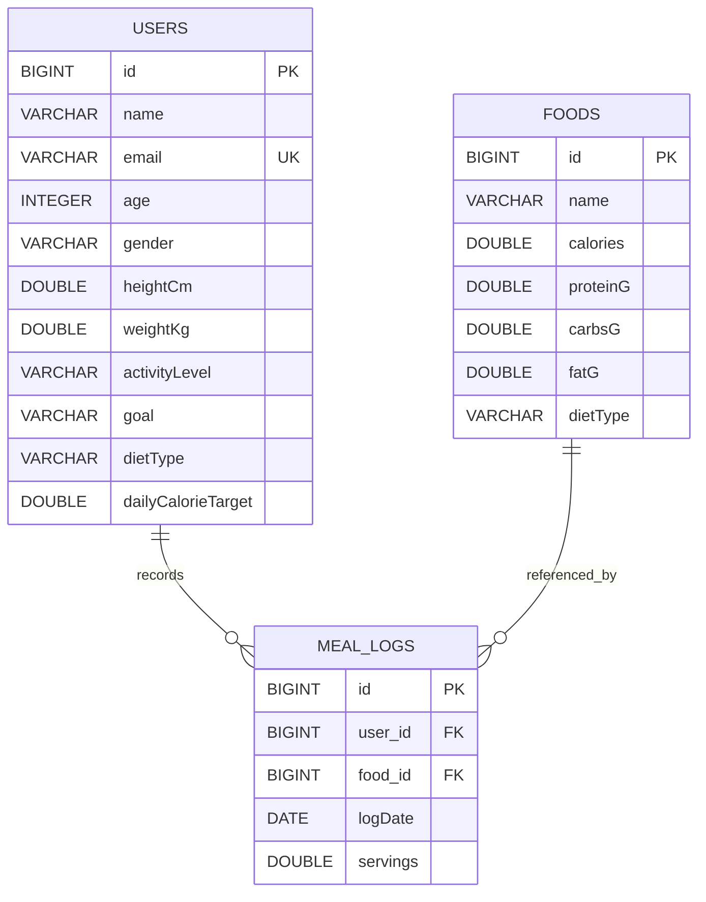

# Database Design

## Database configuration
- Database: MySQL
- Schema name in `application.properties`: `nutritiondb`
- ORM: Hibernate through Spring Data JPA
- Schema mode: `spring.jpa.hibernate.ddl-auto=update`

## Entities and fields

### `users` — `User`
| Java field | Meaning | Validation/mapping |
|---|---|---|
| `id` | Primary key | Generated identity |
| `name` | User name | `@NotBlank` |
| `email` | Email | `@NotBlank`, `@Email`, unique and non-null column |
| `age` | Age | `@NotNull`, `@Min(1)` |
| `gender` | Gender enum | Required, stored as enum string |
| `heightCm` | Height in cm | Required, positive |
| `weightKg` | Weight in kg | Required, positive |
| `activityLevel` | Activity enum | Required, enum string |
| `goal` | Goal enum | Required, enum string |
| `dietType` | Diet enum | Required, enum string |
| `dailyCalorieTarget` | Calculated target | Set by `UserService` |
| `mealLogs` | Inverse collection | `@OneToMany(mappedBy="user")`, ignored in JSON |

### `foods` — `Food`
| Java field | Meaning | Validation/mapping |
|---|---|---|
| `id` | Primary key | Generated identity |
| `name` | Food name | Nonblank, non-null column |
| `calories` | Calories per stored food item | Non-negative |
| `proteinG` | Protein grams | Non-negative |
| `carbsG` | Carbohydrate grams | Non-negative |
| `fatG` | Fat grams | Non-negative |
| `dietType` | `VEG` or `NON_VEG` | Required, enum string |

### `meal_logs` — `MealLog`
| Java field | Meaning | Validation/mapping |
|---|---|---|
| `id` | Primary key | Generated identity |
| `user` | User associated with log | `@ManyToOne`, `user_id`, non-null, lazy |
| `food` | Food associated with log | `@ManyToOne`, `food_id`, non-null, eager |
| `logDate` | Date consumed | Required |
| `servings` | Number of servings | Required and positive |

## Entity relationship diagram

The diagram reflects entity mappings and the intended foreign-key columns. Confirm the physical schema in MySQL if exact database column types or constraints are required for submission.

## Enumerations
- `Gender`: `MALE`, `FEMALE`
- `ActivityLevel`: `SEDENTARY`, `LIGHT`, `MODERATE`, `ACTIVE`
- `Goal`: `LOSE`, `MAINTAIN`, `GAIN`
- `DietType`: `VEG`, `NON_VEG`

Enums are stored as strings with `@Enumerated(EnumType.STRING)`.

## Repositories and queries
- `UserRepository extends JpaRepository<User, Long>`: standard CRUD.
- `FoodRepository extends JpaRepository<Food, Long>`: standard CRUD and `findByDietType`.
- `MealLogRepository extends JpaRepository<MealLog, Long>`: standard CRUD, `findByUserIdAndLogDate`, and custom delete queries by user ID and food ID.

## Initialization and seed data
Create the `nutritiondb` database before launching the app. Hibernate's update mode creates/updates mapped schema. `DataSeeder` inserts 20 example foods only when `foodRepository.count() == 0`.

## Deletion and referential integrity
`UserService.delete` removes a user's meal logs before deleting the user. `FoodService.delete` removes meal logs for a food before deleting that food. Both operations are marked transactional.

## Important source-integrity warning
The uploaded `MealLogRepository.java` contains unrelated prose inserted into the Java interface body. Its intended query declarations are visible later in that file, but the pasted prose makes the source invalid Java. Do not treat this as a valid schema/query implementation until the file is repaired and tests run.
